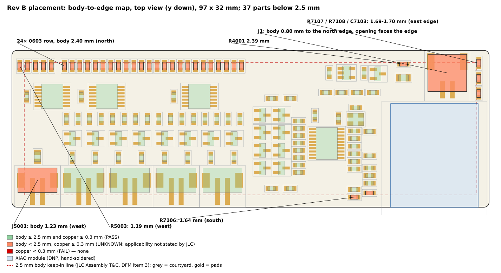

# RB-02F — JLC Economic Edge-Clearance Clarification Package

Date: 2026-10-10. Branch `hardware/emg-rev-b`. Nothing committed; placement, schematic, PCB and routing untouched.
**Vendor response: NONE. Economic eligibility is NOT proven.** The edge-clearance risk is **OPEN**.

## 1. Re-examination of the official text

All pages re-read on 2026-10-10 (archived text in `rev-b-xiao/evidence/rb02e/jlc_sources/`).

| Statement | Where | Applies to | What it does not say |
|---|---|---|---|
| The distance between component **bodies** and the **board edge** must be ≥ 2.5 mm | *Terms and Conditions of JLCPCB Assembly Service* §2 "Notes on DFM", item 3 — https://jlcpcb.com/help/article/Terms-and-Conditions-of-JLCPCB-Assembly-Service | The T&C of the assembly service as a whole; the sentence has no service qualifier. It sits in a list with generic IPC-7351B density and thermal notes | Not stated for Standard only; not stated as waived for Economic; "board edge" is not defined as board outline versus panel rail |
| For Economic assembly, boards are panelised and routed out afterwards (≈ 0.2 mm tolerance); JLC *suggests* traces and components be > 0.3 mm from the board edge | *PCB Assembly FAQs (Part 2)* item 14 "Reminder for economic assembly design" — https://jlcpcb.com/help/article/pcb-assembly-faqs-part-2 | Economic only; wording is "suggest" and concerns the depanelling route tolerance | Does not mention 2.5 mm, does not say 2.5 mm is replaced |
| Edge rails and fiducials "Not necessary" for Economic; delivery format "Single PCB" or "Panel with mouse bites" | Capabilities table — https://jlcpcb.com/capabilities/pcb-assembly-capabilities | Economic | Silent on component-to-edge distance |
| Tooling holes, edge rails and fiducials are required for assembly; if the customer's file lacks them JLC adds or modifies them by default | T&C §5 item 5 | All assembly orders | Does not say where the 2.5 mm is measured |
| 5 mm process edges recommended; components near the board edge "might collide with the guide rails" if the process edge is too narrow | https://jlcpcb.com/help/article/specifications-for-adding-process-edges-and-positioning-holes | SMT service generally | Does not mention the 2.5 mm number or Economic |
| Assembled boards typically ship with manufacturing rails attached; depanelisation is an optional "panel removal" service | Capabilities FAQ | Both | Price of panel removal not listed |

**Conclusion of the re-examination.** The two edge numbers are *not* reconciled by any official text. The 2.5 mm sentence is
categorical ("must") and unqualified; the Economic FAQ is the only page that gives a number specific to Economic, and it is a
suggestion about route tolerance. A plausible reading — 2.5 mm exists to keep parts clear of the conveyor guide rails when
there is no process edge, and Economic panels always have JLC's own rails — is a **hypothesis built from the process-edge
article, not something JLC states**. No third-party summary (including search-engine summaries) is used as evidence. If JLC does
not answer, Economic eligibility stays unproven.

Not resolved by documentation: (a) whether 2.5 mm is measured to our outline or to the panel rail, (b) whether Economic orders are
checked against it by CAM/DFM, (c) where mouse-bite tabs go.

## 2. Exposure

* 126 factory-populated SMT parts; **37** have a body closer than 2.5 mm to the outline (**0** closer than 0.3 mm; smallest
  copper/tail distance 0.50 mm). Parts per group: 24 passives in the north row (2.40 mm, 0.10 mm short), R4001 (2.39), R3009 (2.49),
  R7106 (1.64), R7107/R7108/C7103 (1.69–1.70), R5003 (1.19), J5001 (1.23), **J1 (0.80)**.
* Per-part table: `rev-b-xiao/evidence/rb02f/affected_components.csv` (and the table below).
* Image: `rev-b-xiao/evidence/rb02f/rb02f_edge_map.png` (+ `_ne.png`, `_w.png`, `.svg`).



## 3. Deliverables

| Deliverable | File |
|---|---|
| Support inquiry, ready to send (not sent) | `REVB_RB02F_JLC_SUPPORT_INQUIRY.md` |
| Annotated placement image | `rev-b-xiao/evidence/rb02f/rb02f_edge_map.png` (+ NE/W zooms, SVG) |
| Affected-component table (37) | `rev-b-xiao/evidence/rb02f/affected_components.csv` / `.md` |
| Minimal-change fallback plan | `REVB_RB02F_FALLBACK_PLAN.md` (+ `evidence/rb02f/fallback_*`) |
| Reproduction | `tools/rb02f_variant.py`, `tools/rb02f_annotate.py`, `tools/run_rb02f_checks.sh` |

## 4. Affected components (37 of 126; body-to-edge by the F.Fab outline)

| # | Ref | Value | MPN / part | Footprint | Nearest edge | Body→edge (mm) | Courtyard→edge | Pad→edge | Short of 2.5 by |
|---|---|---|---|---|---|---|---|---|---|
| 1 | J1 | S2B-PH-SM4-TB | S2B-PH-SM4-TB(LF)(SN) | JST_PH_S2B-PH-SM4-TB_Horizontal | north | 0.80 | 0.10 | 0.60 | 1.70 |
| 2 | R5003 | 100k | generic (Basic, RB-03) | R_0603 | west | 1.19 | 0.87 | 1.12 | 1.31 |
| 3 | J5001 | B2B-PH-SM4-TB | B2B-PH-SM4-TB(LF)(SN) | JST_PH_B2B-PH-SM4-TB_Vertical | south | 1.23 | 0.00 | 0.50 | 1.27 |
| 4 | R7106 | 150k | generic (Basic, RB-03) | R_0603 | south | 1.64 | 1.32 | 1.57 | 0.86 |
| 5 | R7107 | 1M | generic (Basic, RB-03) | R_0603 | north | 1.69 | 1.12 | 1.38 | 0.81 |
| 6 | R7108 | 1M | generic (Basic, RB-03) | R_0603 | east | 1.69 | 1.37 | 1.62 | 0.81 |
| 7 | C7103 | 100nF | generic (Basic, RB-03) | C_0603 | east | 1.70 | 1.37 | 1.62 | 0.80 |
| 8 | R4001 | 4.7 | generic (Basic, RB-03) | R_0603 | north | 2.39 | 2.07 | 2.33 | 0.11 |
| 9 | C101 | 2.2uF | generic (Basic, RB-03) | C_0603 | north | 2.40 | 1.72 | 1.98 | 0.10 |
| 10 | C102 | 2.2uF | generic (Basic, RB-03) | C_0603 | north | 2.40 | 1.72 | 1.98 | 0.10 |
| 11 | C201 | 2.2uF | generic (Basic, RB-03) | C_0603 | north | 2.40 | 1.72 | 1.98 | 0.10 |
| 12 | C202 | 2.2uF | generic (Basic, RB-03) | C_0603 | north | 2.40 | 1.72 | 1.98 | 0.10 |
| 13 | C301 | 2.2uF | generic (Basic, RB-03) | C_0603 | north | 2.40 | 1.72 | 1.98 | 0.10 |
| 14 | C302 | 2.2uF | generic (Basic, RB-03) | C_0603 | north | 2.40 | 1.72 | 1.98 | 0.10 |
| 15 | C401 | 2.2uF | generic (Basic, RB-03) | C_0603 | north | 2.40 | 1.72 | 1.98 | 0.10 |
| 16 | C402 | 2.2uF | generic (Basic, RB-03) | C_0603 | north | 2.40 | 1.72 | 1.98 | 0.10 |
| 17 | C5001 | 1uF | generic (Basic, RB-03) | C_0603 | north | 2.40 | 1.72 | 1.98 | 0.10 |
| 18 | C5002 | 100nF | generic (Basic, RB-03) | C_0603 | north | 2.40 | 1.72 | 1.98 | 0.10 |
| 19 | R103 | 100k | generic (Basic, RB-03) | R_0603 | north | 2.40 | 1.72 | 1.98 | 0.10 |
| 20 | R104 | 100k | generic (Basic, RB-03) | R_0603 | north | 2.40 | 1.72 | 1.98 | 0.10 |
| 21 | R107 | 1.0k | generic (Basic, RB-03) | R_0603 | north | 2.40 | 1.72 | 1.98 | 0.10 |
| 22 | R108 | 1.0k | generic (Basic, RB-03) | R_0603 | north | 2.40 | 1.72 | 1.98 | 0.10 |
| 23 | R203 | 100k | generic (Basic, RB-03) | R_0603 | north | 2.40 | 1.72 | 1.98 | 0.10 |
| 24 | R204 | 100k | generic (Basic, RB-03) | R_0603 | north | 2.40 | 1.72 | 1.98 | 0.10 |
| 25 | R207 | 1.0k | generic (Basic, RB-03) | R_0603 | north | 2.40 | 1.72 | 1.98 | 0.10 |
| 26 | R208 | 1.0k | generic (Basic, RB-03) | R_0603 | north | 2.40 | 1.72 | 1.98 | 0.10 |
| 27 | R303 | 100k | generic (Basic, RB-03) | R_0603 | north | 2.40 | 1.72 | 1.98 | 0.10 |
| 28 | R304 | 100k | generic (Basic, RB-03) | R_0603 | north | 2.40 | 1.72 | 1.98 | 0.10 |
| 29 | R307 | 1.0k | generic (Basic, RB-03) | R_0603 | north | 2.40 | 1.72 | 1.98 | 0.10 |
| 30 | R308 | 1.0k | generic (Basic, RB-03) | R_0603 | north | 2.40 | 1.72 | 1.98 | 0.10 |
| 31 | R403 | 100k | generic (Basic, RB-03) | R_0603 | north | 2.40 | 1.72 | 1.98 | 0.10 |
| 32 | R404 | 100k | generic (Basic, RB-03) | R_0603 | north | 2.40 | 1.72 | 1.98 | 0.10 |
| 33 | R407 | 1.0k | generic (Basic, RB-03) | R_0603 | north | 2.40 | 1.72 | 1.98 | 0.10 |
| 34 | R408 | 1.0k | generic (Basic, RB-03) | R_0603 | north | 2.40 | 1.72 | 1.98 | 0.10 |
| 35 | R5004 | 100k | generic (Basic, RB-03) | R_0603 | north | 2.40 | 1.72 | 1.98 | 0.10 |
| 36 | R5005 | 10k | generic (Basic, RB-03) | R_0603 | north | 2.40 | 1.72 | 1.98 | 0.10 |
| 37 | R3009 | 4.7k | generic (Basic, RB-03) | R_0603 | south | 2.49 | 2.17 | 2.42 | 0.01 |


## 5. Fallback summary

Moving the north edge 1.8 mm (97 × 33.8 mm) plus rigid shifts of 81 footprints gives **0 parts below 2.5 mm**, unchanged DRC (0 errors,
0 parity issues, 273 unconnected), and all placement checks except the intentional board-size check. A no-growth variant fixes
35 of 37; J1 and R7107 cannot be fixed without growing the board. **J1 is the only part whose geometry inherently conflicts**
with a 2.5 mm body clearance (side-entry plug corridor). Details and alternatives: `REVB_RB02F_FALLBACK_PLAN.md`.

## 6. Decision rule (applied)

| JLC answer | Action |
|---|---|
| Confirms the placement is acceptable for Economic (in writing, or via a DFM/quote result for the real package) | Mark Economic edge risk CLOSED, proceed to RB-03 |
| Requires 2.5 mm | Review and implement the fallback plan (or a variant of it), re-run RB-02/RB-02E checks, then RB-03 |
| Cannot clarify / no answer | Edge risk stays **OPEN**; Economic eligibility **not proven**. Owner may still choose to adopt the fallback pre-emptively (cost: +1.8 mm board height, no electrical change) rather than route on an open question |

Routing is not started. Because routing multiplies the cost of any later translation, the recommendation is **not to start RB-03
until JLC answers or the owner explicitly accepts the open risk (or adopts the fallback now)**. This is a recommendation, not a gate
set by JLC.

## 7. Final gate

```
JLC RESPONSE RECEIVED:                  NO
ECONOMIC EDGE RULE:                     2.5 mm (T&C) vs 0.3 mm (Economic FAQ): UNRESOLVED
ECONOMIC ELIGIBILITY:                   NOT PROVEN (design compatible with all published capability limits)
PARTS BELOW 2.5 mm BODY-TO-EDGE:        37 of 126 (0 below 0.3 mm)
INHERENT EDGE PART:                     J1 (side-entry battery connector)
FALLBACK AVAILABLE:                     YES (97 x 33.8 mm, 81 footprints translated, no electrical change) - validated on scratch copies only
PLACEMENT CHANGED:                      NO
SCHEMATIC / ROUTING / GERBERS / ORDER:  UNCHANGED / NOT STARTED / NONE / NONE
READY FOR RB-03 ROUTING:                CONDITIONAL on JLC answer or owner acceptance of the open risk
```
