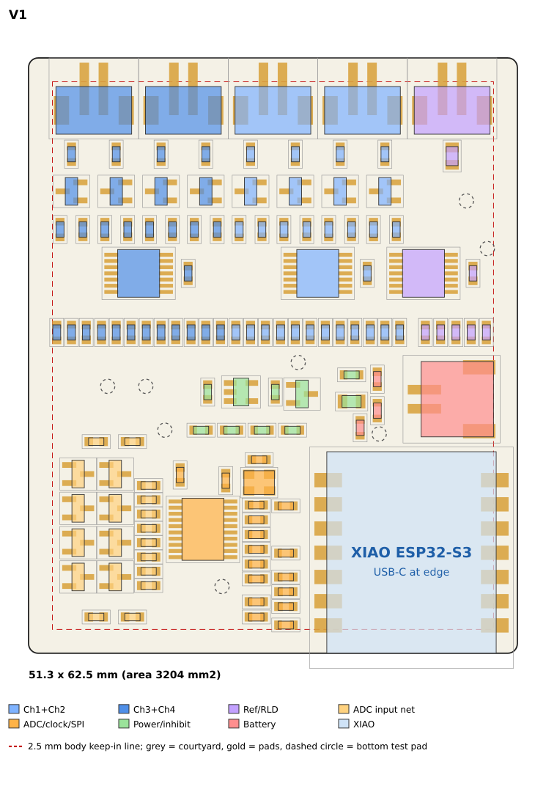
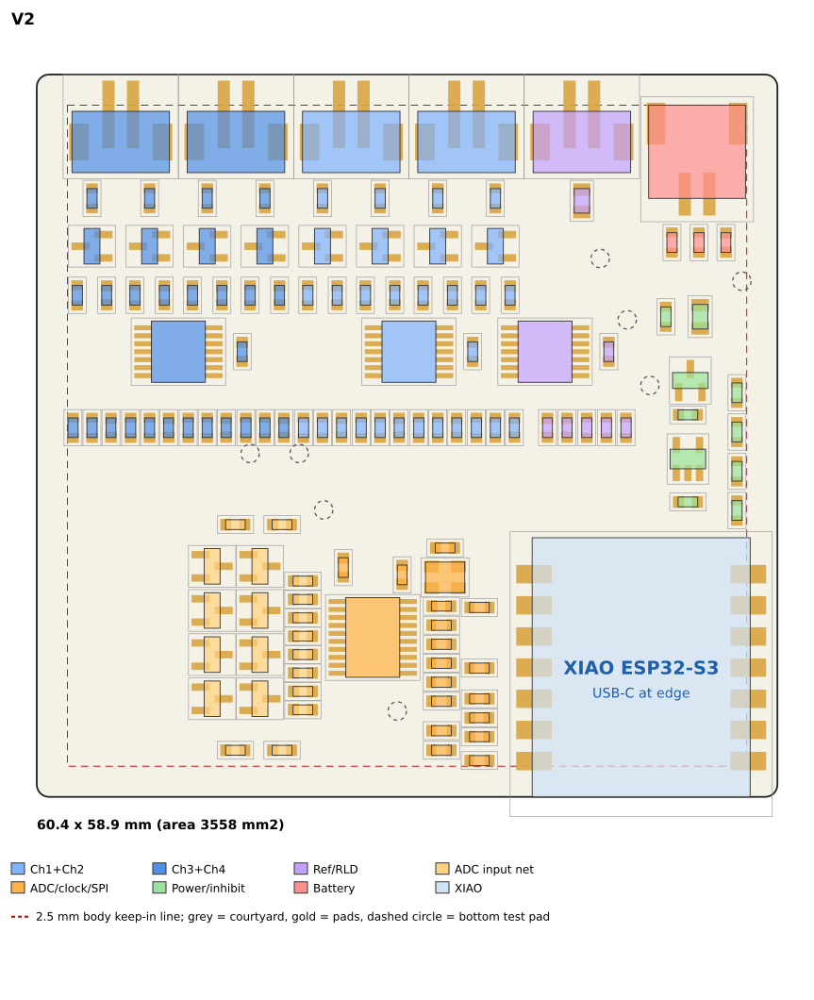

# RB-02G — Compact Wrist-Wearable Layout Study

Date: 2026-10-11. Branch `hardware/emg-rev-b`. **Not committed. Main PCB not modified. No routing.** Waiting for approval.
Companion: `REVB_RB02G_VARIANT_COMPARISON.md`. Evidence: `rev-b-xiao/evidence/rb02g/` (per-variant checks, DRC, edge audit,
metrics, images, scratch boards `variants/RB02G_V*_whatif.kicad_pcb`). Tools: `rb02g_layouts.py`, `rb02g_variants.py`,
`rb02g_build.py`, `rb02g_check.py`, `rb02g_metrics.py`, `rb02g_render.py`, `rb02g_run.py`.

Images: `rev-b-xiao/evidence/rb02g/V1/img.png`, `V2/img.png`, `V1R/img.png` (top views, coloured by functional block, 2.5 mm
keep-in line) and `size_comparison.png` (to scale).




## 1. Why the board is 97 mm long

The RB-02 placement is two blocks of almost equal size laid end to end, each about 30 mm tall:

| Block (RB-02 frame) | Content | Courtyard box | Courtyard area |
|---|---|---|---|
| Zone A | 5 electrode JST connectors, 8 hi-Z input cells, 3 TLV9064, reference/RLD parts (75 parts) | 47.0 × 30.3 mm | 880 mm² |
| Zone B/C | ADC input network, ADS131M04, oscillator, SPI/DVDD parts (43 parts) | 26.3 × 25 mm | 297 mm² |
| Zone D | XIAO module with toes and USB-C overhang | 21.4 × 23.2 mm | 497 mm² |
| Power strip + battery connector | LDO, inhibit, J1 (16 parts) | 33 × 10 mm | 171 mm² |
| **Total** | 135 footprints | board 97 × 32 = 3104 mm² | **1844 mm² (58 %)** |

47.0 (Zone A) + 47.6 (Zone B/C/D) + margins = 97 mm. The elongation is **the initial linear zone arrangement, not a hardware
constraint**: nothing in the design requires Zone A to sit beside Zone C/D. What *is* genuine:

| Genuine constraint | Value | Effect |
|---|---|---|
| Five JST B2B connectors | 9.4 × 8.5 mm courtyard each, tails 0.5 mm from the edge | 47 mm in one row (42.5 mm if rotated); 400 mm² = 22 % of all courtyard area |
| Hi-Z cell chain per leg (Rs → clamp → 100 pF / 10 M → follower) | ≈ 13 mm long, P/N mirrored | defines a 30 mm tall channel strip |
| XIAO module | 17.8 × 21.1 mm, castellations 1.30 mm outside each long edge, USB-C overhang 1.5 mm | needs an edge; iron-access band 1.5 mm outside the toes, ≤ 1.2 mm tall parts to 4 mm |
| BAT+ post and 11 underside keep-outs | post hole Ø1.40, 3 mm clear access | fixed relative to the module |
| ADC + oscillator ≤ 5 mm (OUT pad 3.61 mm) and the AIN network | 26 × 25 mm cluster | rigid with the module (SPI parts on the toes) |
| Single ground plane | In1 full; In2 under zones A/B | any 2-D arrangement must keep it uninterrupted |

So the area floor is set by parts and spacing (≈ 3050 mm² at 60 % courtyard utilisation); only the **shape** is free.

## 2. Method

* Every functional group is a rigid block taken unchanged from the validated RB-02 placement (A12 = channels 1+2, A34 =
  channels 3+4, REF = J5001 + RLD parts, AIN, ADC, PWR, BATT, XIAO). Blocks are only rotated by multiples of 90° and translated,
  so hi-Z cells, P/N symmetry, ADC/oscillator geometry, decoupling distances, the XIAO footprint, post and keep-outs are
  identical to RB-02. Partition proof: 135 refs, no overlap, none missing (`check_partition`).
* Boards are built with the unchanged `rb02_build_pcb.py` (real KiCad footprints, real nets, DNP flag) and checked by the
  RB-02 checker (28 checks, module translated back to its frame, plus C29 USB-edge), KiCad 10.0.6 DRC with schematic parity,
  the RB-02E edge/assembly audit and netlist-based routing proxies. Not a router; no tracks.

## 3. Reorganised zones

* **Zone A turned 180° and moved above Zone B/C/D** (V1, V2): all five electrode connectors are on one edge (north); signal
  flows down through Rs → clamp → amp → AC band → ADC input network → ADC, with the module at the opposite (south) edge. Buffered
  runs shrink: longest follower → clamp run 51.9 → 40.7 mm (V1) / 38.3 mm (V2).
* **Hi-Z inputs short and protected:** untouched (rigid cells); P and N cells keep identical rotation and row.
* **Ground plane:** In1 stays one solid plane under everything; In2 GND follows the outline except the module/RF corner (same
  RB-00.6 rule). The Zone-A rule area (no SPI/control tracks) is now the top 31 mm band.
* **Battery connector (J1):** V1 places it above the module and turns it so the plug leaves through the east edge; V2 puts it in
  the north-east corner so its plug leaves through the same edge as the electrode cables. A 7 × 9 mm plug corridor check (C30)
  caught a first V1 draft whose plug faced the channel cells (see the correction log in the comparison).
* **Connector orientation:** B2B connectors are top-entry; cable direction is set by the enclosure, not the footprint.
  Side-entry parts would be a BOM change (not needed).

## 4. Wearability

| Aspect | Current 97 × 32 | V1 51.3 × 62.5 | V2 60.4 × 58.9 |
|---|---|---|---|
| Long × short | 97 along the arm | 62.5 along, 51.3 across | ~59–60 both ways |
| Edge lift of a flat board across the limb, R = 30 / 40 mm (generic, not measured) | 4.6 mm / 3.3 mm | 14.4 mm / 9.3 mm | wider than the limb / 13.8 mm |
| Rigid length along the arm | 97 mm | 62.5 mm | 58.9 mm |
| Cable exit | south edge, 5 cables | north edge, 5 cables | north edge, 5 + battery |
| USB-C | south edge | south edge, opposite the cables | same |
| Height above PCB (assumed seated heights) | 6.6 mm JST + 1.6 PCB | same | same |
| Pressure points | long rigid body | corners (r = 1.0 mm) and tall JST row | same |

* A square PCB is **not** automatically more ergonomic: a flat rigid board lifts its edges off a curved limb, and V2 (60 mm
  across) is worse than V1 (51 mm) and than the current 32 mm width in that one respect. The electrodes are remote (JST cables),
  so the PCB sits like a watch head on a strap; footprint, thickness and edges matter more than skin contact.
* The long axis should lie along the arm (no curvature): V1 is 62.5 along, 51 across. The current 97 mm is the real problem.
* Thickness is unchanged from RB-02: ≈ 8 mm above the PCB (assumed JST height 6.6 mm) plus battery plus enclosure. The battery is
  not defined by the frozen design; a small 1S pouch fits under either variant. V2 leaves a ≈ 10 × 27 mm free pocket for strap
  lugs; the frozen 135-part BOM has no mounting holes.
* The skin side carries only eight bare Ø1.5 mm test pads (VBAT, AFE_3V0, DVDD_F, VCM, RLD_SAFE, AFE_EN, GND ×2): they need an
  insulating cover or enclosure floor before skin contact (unchanged from RB-02).
* Corner radius is 1.0 mm. A 3 mm radius for comfort needs ≈ 0.5 mm of extra margin at the two connector corners (courtyards are
  flush with the north edge): an enclosure decision.
* Strap mounting, strain-relief posts and enclosure walls are not modelled (no measurements).

## 5. Economic PCBA

All variants keep: 4 layers; top-side-only SMT (126 parts, 0 bottom); XIAO DNP and absent from the CPL; BAT+ post manual; no
separate brain board; no test PCB. **0 parts below 0.3 mm** in every variant; **0 below 2.5 mm in V1/V2** (RB-02F: 37). The
RB-02F question therefore does not constrain V1/V2; it remains OPEN for the current board and for V1R (9 parts). Unchanged open
items: mouse-bite tab positions against connector tails (0.5 mm from the edge), factory acceptance, Basic/Extended part choice.

## 6. Risks specific to the folded arrangement

| Risk | Evidence | Mitigation / action |
|---|---|---|
| Hi-Z inputs closer to the ESP32 module | nearest hi-Z node: 30.6 mm → 18.1 mm (V1), 16.2 mm (V2); the module's RF and regulators are the aggressors | one In1 ground plane under everything; keep SPI/clock away from Zone A (custom rules already 2 mm / 1 mm); verify with the bring-up TPs; fallback: increase the gap by lowering the module block only |
| Buffered runs cross the power strip / ADC area | 27–41 mm low-impedance runs | route on F.Cu over solid In1; keep the LDO strip off the straight path |
| Local density around AIN/ADC | rigid, same as RB-02 | none new |
| Five connectors in one 47 mm row | same pitch as RB-02 | none new |

## 7. Architecture changes

**None required** for V1/V2/V1R: no schematic, netclass, footprint, DNP or BOM change. Separate decisions, not implemented:
mounting holes / strap lugs (new non-electrical footprints), side-entry electrode connectors for a lower profile, a rigid-flex
tail for the connectors, a 3 mm corner radius.

## 8. Recommendation

1. **V1 51.3 × 62.5 mm**: recommended.
2. V2 60.4 × 58.9 mm: if a square footprint is preferred over 15 % extra area.
3. V1R 48.6 × 62.5 mm: only after JLCPCB confirms the 2.5 mm note is not applicable.

To adopt a variant, `rb02g_variants.py` holds the exact transforms; the project PCB would be regenerated from them and the
RB-02 reports re-issued after your approval. RB-03 should not start on the 97 × 32 board.

## 9. Final decision

```
CURRENT PCB:                       97 x 32 mm
BEST COMPACT CANDIDATE:            V1  51.3 x 62.5 mm (area 3204 mm2, aspect 1.22); square alternative V2 60.4 x 58.9 mm
ALL COMPONENTS FIT:                YES (135 / 135, no overlapping courtyards)
PLACEMENT DRC:                     PASS (0 errors, 0 schematic-parity issues; 273 unconnected = unrouted; 1 accepted U1 warning)
EMG LAYOUT QUALITY:                CONDITIONAL (hi-Z cells and P/N symmetry unchanged; hi-Z-to-module distance 31 -> 18 mm to verify at bring-up)
JLC ECONOMIC PCBA:                 COMPATIBLE by design (0 parts < 2.5 mm, 0 < 0.3 mm); factory acceptance unproven
BAT+ POST PRESERVED:               YES (CAD position, drill 1.40, 11 keep-outs)
XIAO HAND-SOLDER ACCESS:           PASS
ROUTING FEASIBILITY:               CONDITIONAL (proxies better than RB-02: HPWL -8 %, utilisation 56 %; not attempted)
ESTIMATED WEARABILITY IMPROVEMENT: longest dimension 97 -> 62.5 mm (-36 %), aspect 3.0 -> 1.2, area +3 %, all cables on one edge
RECOMMENDED FINAL DIMENSIONS:      51.3 x 62.5 mm (V1)
BLOCKERS:                          owner approval of V1 vs V2; enclosure/battery size and strap method undefined;
                                   hi-Z-to-RF distance and skin-side test pads need a decision before RB-03
MAIN PCB MODIFIED / ROUTED / COMMITTED:  NO / NO / NO
```
